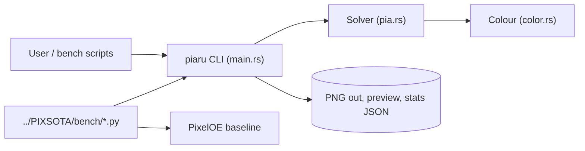

# PIARU

How the system is built. `DECISIONS.md` overrules this file wherever they disagree. Cite decision codes (`B2`) instead of restating the choice or its reason.



## A. Purpose and scope

Turns concept art into pixel art with a hard palette limit, using Pixelated Image Abstraction (A2) in Oklab (A3).

**Goals**
- Faithful, fast Rust port of the method, with checked parity against Pyxeled (A4).
- Optional artist control: importance map (C1); experimental edge weight (C2).
- A benchmark that decides whether experimental features ship (C3, C4, D1). The harness lives in the sibling `../PIXSOTA` checkout and runs this CLI.

**Non-goals**
- GPU or ML methods.
- A GUI, for now (E2).

## B. Context

| Actor / external system | Direction | Interface |
|---|---|---|
| User | in | CLI (`piaru --help`) |
| Image files | in / out | PNG / JPEG / WebP in; PNG out |
| Benchmark harness (`../PIXSOTA/bench/`) | both | Runs the CLI and reads `--stats` JSON |
| PixelOE, Pyxeled (`refs/`) | in | Baseline and reference, Python |

## C. Components

| Component | Responsibility | Depends on | Owns (data/state) |
|---|---|---|---|
| `src/main.rs` | Argument parsing, image I/O, input downscale (B3), stats JSON | lib | Output files |
| `src/pia.rs` | Solver: superpixel refinement, MCDA association and palette refinement, splits, final merge (B4) | color, rayon | `Params`, `Output`, `Stats` |
| `src/color.rs` | sRGB ↔ Oklab ×100 / CIELAB, distance | none | `Space`, `F` (B2) |
| `src/lib.rs` | Public API re-exports, peak RSS | pia, color | none |
| `bench/parity.py`, `bench/metrics.py` | Pyxeled parity check against the reference output | CLI release build, `refs/` | nothing |

## D. Key flows

**Pixelate an image**
1. CLI loads the image, picks the output grid from `-s` or `--width/--height`, downscales the input to ≤ factor × grid (B3).
2. The solver converts to the working space and seeds a grid of superpixels with K = 1 at T0 = 35.
3. Each iteration: SLIC-style assignment of pixels to the 3×3 neighbouring superpixels, with Laplacian (0.4) and bilateral (0.5) smoothing, then one fused MCDA pass. No N×K matrix is stored.
4. On palette convergence: T ← 0.7·T; split separated sub-colours up to K_max, otherwise perturb along the principal axis (B6).
5. At T_final: merge any leftover pairs (B4), apply saturation (B5), write one pixel per superpixel.

**Parity check**
1. `bench/parity.py` loads the source, the Pyxeled output and one or more PIARU outputs.
2. `bench/metrics.py` computes ΔE against the box-downsampled source, edge retention and palette distances.
3. The result is compared against the parity numbers recorded in `docs/PORTING.md` (A4, B1).

The benchmark flow (inputs, columns, blind sheet, verdict) lives in `../PIXSOTA` (see its `README.md`); it calls this CLI and reads `--stats`.

## E. Data

| Entity | Fields that matter | Stored in | Lifetime |
|---|---|---|---|
| Palette | ≤ K_max colours (hard limit, B4) | Memory, `palette_srgb` in stats | Per run |
| Superpixel | Position, mean colour, p(s) (importance-weighted, C1) | Memory | Per run |
| Stats JSON | `params`, `stats.timings`, `iterations`, `peak_rss_kib`, `wall_ms` | `--stats` path | File |
| Benchmark results | One CSV row per image × size × K × method | `../PIXSOTA/data/` and `../PIXSOTA/bench/out/` | Outside this repo |

## F. Interfaces and contracts

| Interface | Kind | Spec location |
|---|---|---|
| `piaru` CLI | CLI | `src/main.rs` (`Cli`) |
| `piaru::run(&Input, &Params) -> Output` | Rust API | `src/pia.rs` |
| Stats JSON | File | `src/main.rs`, read by `../PIXSOTA/bench/run_bench.py` |

## G. Stack

| Need | Choice | Decision |
|---|---|---|
| Language | Rust 2021 | A1 |
| Parallelism | rayon | none |
| Image I/O | image 0.25 (png, jpeg, webp) | none |
| CLI | clap 4 | none |
| Parity check | Python 3, numpy, Pillow | A4 |

## H. Quality targets

No numeric targets (D3): quality is judged by the blind rating, and cost is reported as peak memory and solve time. These are measurements, not commitments.

| Attribute | Measured | How checked |
|---|---|---|
| Palette limit | Never exceeds `-k` | `cargo test respects_hard_palette_limit_and_finds_regions` |
| Parity (compat, f64) | ΔE vs Pyxeled 0.46, 97 % of pixels within ΔE 5 | `bench/parity.py`, `docs/PORTING.md` |
| Solve time, hunter, 8 threads | 128×80: 0.9 s · 256×160: 3.4 s · 512×320: 13–15 s | `--stats`, `bench/out/prof/` |
| Peak RSS, same runs | 56 / 69 / 112 MiB | `--stats` |

## I. Constraints

- Heavy jobs run remotely (A5).
- CPU only.
- `--pyxeled-compat` must keep reproducing Pyxeled (A4).
- Benchmark images and licences: `../PIXSOTA/bench/images/ATTRIBUTION.md`.

## J. Repository layout

```
src/            crate: main.rs (CLI), lib.rs, pia.rs (solver), color.rs
bench/          parity.py + metrics.py (parity check only); out/ generated
docs/           PORTING.md (Pyxeled divergences, parity numbers)
refs/           vendored Pyxeled and PixelOE (git-ignored, read-only)
../PIXSOTA/     research project: paper, benchmark harness, literature review, study
```
