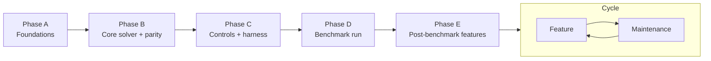

# Roadmap

Planned work, in order. `DECISIONS.md` overrules this file wherever they disagree. Phases are lettered (Phase A, Phase B, and so on) and match decision codes. A phase starts only when its decisions are Decided.

**Scope:** Pix++ only.

**Task format:** `- [ ] <task> (<codes>). Done when: <check>`
- Codes are the decisions the task depends on.
- The check is something the agent can run or observe: a command, a test, a visible behavior.
- A task fits one session and one reviewable diff. If it doesn't, split it.
- Tasks run top to bottom. `[P]` after the checkbox marks a task that can run in parallel with its neighbors because it touches different files.

Phases A to C were built before DLAD was adopted, so their B and C rows are still Questions. Triaging them does not block Phase D, but a change to any of them reopens the matching task.

## Phase A: Foundations

**Goal:** the method, language, colour space and reference are fixed.
**Exit:** A1 to A5 Decided.

- [x] Fix method, language, colour space, reference and compute location (A1–A5). Done when: rows Decided.

## Phase B: Core solver and Pyxeled parity (milestones 1–3)

**Goal:** a working Rust port that matches Pyxeled in compat mode and runs at 512.
**Exit:** parity table in `docs/PORTING.md`; 512 profile in `bench/out/prof/`.

- [x] Crate, CLI and MCDA core (A1, A2, B4). Done when: `cargo test` passes.
- [x] Pyxeled parity with compat mode (A4, B1, B2). Done when: `bench/parity.py` shows compat f64 ΔE vs Pyxeled < 1.
- [x] 512 output profile (B2, B3). Done when: `bench/out/prof/hunter_512.json` exists with timings.

## Phase C: Importance map, edge weight, benchmark harness (milestones 4–5)

**Goal:** artist controls exist, and a harness can judge them.
**Exit:** smoke benchmark runs end to end.

- [x] Importance map (C1). Done when: `--importance` changes p(s) and the run completes.
- [x] Experimental edge weight, off by default (C2). Done when: no edge map means no change in output.
- [x] Benchmark harness, blind sheet and scoring (C3, C4). Done when: the 2-image smoke run at 128 is in `bench/out/smoke/`. The harness was research work and is no longer part of this repo.

## Phase D: Benchmark run and report

**Status:** done. The benchmark (C3, D1, D2) was research work; its harness, results and report are not part of this repo.

## Phase E: Post-benchmark features

**Goal:** three methods (E8): base PIA, PIA + importance map, and PixelOE (Phase G). Edge weight cut (E1).
**Not now:** palette per material (E3). GUI moved to Phase J.

- [x] Format once (E4): `cargo fmt` in a formatting-only commit, and add `cargo fmt --check` to the verification commands in `AGENTS.md`. Done when: `cargo fmt --check` is clean and `cargo test` passes. (2026-11-17: outputs byte-identical after formatting.) Each feature that is kept may get its own letter.

- [x] Cut the edge weight (E1, C2): remove `--edge-weight`, its cost term, tests and docs. Done when: `cargo test` and `cargo clippy` pass, `--edge-weight` is rejected, and `bench/parity.py` compat output is unchanged (A4, B1). (2026-11-17: 3 tests pass, 0 clippy warnings, flag rejected; compat, default, smoke and importance outputs byte-identical to before; parity f32 ΔE 1.60.)
- [x] [P] Automatic importance map (E7, C1): `--importance auto` computes spectral-residual saliency in Rust. Done when: a test shows the map matches the harness's `spectral_residual` on a fixed image within 1/255 mean, and `cargo test` and `cargo clippy` pass. (2026-11-17: exact match, 0 differing pixels on 2 fixtures; on the 6 showcase images at 128 the output equals the harness's `pia_imp` byte for byte.)

## Phase G: PixelOE in Rust

**Goal:** a Rust port of PixelOE that matches the Python original and is much cheaper to run (G1).
**Out of scope:** PIA solver changes (E5).
**Exit:** `pixplusplus --method pixeloe` covers every PixelOE stage, and its parity check passes the G5 bound.

- [x] Building blocks (G1, G2): kornia CIELAB conversions, the soft circle kernels, erode/dilate and the local median/min/max stat from `pixeloe/torch/{lab,minmax,outline}.py`. Done when: unit tests compare against values dumped from the Python functions. (2026-11-17: references from `bench/pixeloe_ref.py` on the ASUS, torch 2.15.0, kornia 0.9.2, pixeloe 1.0.0. Kernels, erode and dilate bit-exact; Lab within 6.1e-5 (L 0..100); Lab→RGB within 2.3e-6; local stats within 1.2e-7.)
- [x] Outline expansion and edge-weight map (G2): `torch/outline.py`. Done when: the expanded image and weight map match Python on a test image for every weight mapping and thickness 1–3. (2026-11-17: weights within 1.9e-6, expanded image within 2.4e-7. The padded image `b` is covered by the full-pipeline task.)
- [x] Measure and propose the parity bound (G3, G5). Done when: a G5 proposal with measured numbers is in `DECISIONS.md` for the user. (2026-11-17: stages so far within 2.4e-6; G5 Decided.)
- [x] Downscale modes (G2): contrast-based, k-centroid, Lanczos and the conventional modes. Done when: each matches Python within the G5 bound. (2026-11-17: Lanczos, nearest, nearest-exact, area bit-exact; contrast 6.3e-7, bilinear 6e-8, bicubic 1.2e-7; k-centroid exact on 104/120 patches, the 16 ties follow G6.)
- [x] Sharpen (G2): Laplacian and unsharp. Done when: matches Python within the G5 bound. (2026-11-17: unsharp 1.8e-7, Laplacian 4.2e-7.)
- [x] Colour step (G2): k-means palette, colour transfer, dithering (`torch/color.py`). Done when: matches Python within the G5 bound. (2026-11-17: Gaussian kernels bit-exact via f16 rounding; wavelet blur 1.8e-7, match_color 1.8e-6; k-means palette, quantise, ordered and error-diffusion dither 1.2e-7. Weighted/repeat k-means are checked end to end in the pipeline task.)
- [x] Pipeline and CLI (G4): `pixplusplus --method pixeloe` with PixelOE's options and the existing `--stats` shape. Done when: `cargo test`, `cargo clippy` pass and the smoke run works with `--method pixeloe`. (2026-11-18: 17 upstream configs within 2.4e-6; flags per G7–G9; smoke 128×80 in 1.2 s, 56 MiB; PIA output byte-identical.)
- [x] Parity check (G3, G5): a `bench/` script runs both on the test images. Done when: mean ΔE is under the G5 bound on every image, results in `docs/PORTING.md`, and the 512 peak memory and time are recorded next to the torch numbers. (2026-11-18: 12/12 within G5, worst mean ΔE 0.001; 512: torch 6.0 s / 1.6 GB, Pix++ 15 s / 350 MiB.)

## Phase H: PixelOE speed (G11)

- [x] Profile: per-stage times at 128 and 512. Done when: the slowest stages are listed with times. (2026-11-18, 128 local: match_color 1226 ms of about 1.4 s, wavelet blur; outline 119 ms; contrast 15 ms.)
- [x] Parallelise and speed up the hot stages. Done when: `cargo test` passes, outputs are byte-identical to before on the showcase inputs, and 512 is faster than torch (6.0 s) on the main GPU server. (2026-11-18: byte-identical on all 12; 512 in 3.8–4.7 s against torch's 5.4–6.8 s.)

## Phase I: Any output size (I1)

- [x] Cap the PIA output grid at the input size, with a warning (I1). Done when: a 100×80 input at `-s 128` runs with a warning and the smoke output is unchanged. (2026-11-18: capped to 100×80 with a warning; smoke md5 unchanged.)

## Phase J: Native GUI (J1–J6)

**Goal:** a native desktop app on Linux, Windows and macOS (J5) that runs the three methods (E8) with the same output as the CLI.
**Exit:** `cargo build --release --features gui` gives a `pixplusplus-gui` that opens, runs and saves an image with each method; the default build is unchanged.

- [x] Shared glue (J2): move the image-in, image-out code from `main.rs` into a library module used by the CLI. Done when: `cargo test`, `cargo clippy` and `cargo fmt --check` pass, and the smoke, `--importance auto`, `--pyxeled-compat` and `--method pixeloe -k 16` outputs are byte-identical to before. (2026-11-20: smoke, `--importance auto`, `--pyxeled-compat`, `--method pixeloe` with and without `-k 16`, error diffusion and two size edge cases byte-identical to `0e3ab51`; 28 tests pass, clippy and fmt clean.)
- [x] GUI binary (J1–J4, J6): `pixplusplus-gui` behind the `gui` feature: open, method and settings, run on a worker thread with a spinner, preview, save. Done when: `cargo build --release --features gui` and `cargo clippy --features gui` are clean, the default `cargo build` pulls no GUI crates, and an image saved from the GUI matches the CLI output for the same settings. (2026-11-20: release build and clippy with `gui` clean; `cargo tree` shows no GUI crates in the default build; 6 GUI tests check the GUI image against CLI fixtures for PIA, PIA + auto importance, PixelOE with and without `-k`, and both methods with colour controls. Saving at scale 1 writes that same image.)
- [x] GUI v2 (J7): two methods by full name, importance as a PIA toggle (on), utilitarian layout, shortcuts, stale-result notice, profile format 2 with migration. Done when: clippy with `gui` clean, GUI tests match CLI fixtures, version 1 profiles load with their old meaning. (2026-11-21: 39 library + 16 GUI tests pass, incl. migration of 5 v1 cases; layout checked on a window capture.)
- [ ] Multiplatform builds (J5, Q1). Done when: Windows and macOS builds pass (CI or a remote machine), once Q1 is Decided.

## Phase K: Colour fidelity (K1, K2, K4)

Goal: outputs keep the source's vivid colours, and saturation and contrast are adjustable.

- [x] Colour adjust (K4): a shared Oklab step (chroma × s, lightness stretched by c around the mean lightness) used as a pre-adjust on the input and a post-adjust per output colour, for PIA and PixelOE; flags `--pre-saturation`, `--pre-contrast`, `--saturation`, `--contrast`. Done when: unit tests show neutral values are a no-op, post-adjust never raises the colour count, and the default smoke, `--pyxeled-compat` and `--method pixeloe -k 16` outputs are byte-identical to before; `cargo test`, `cargo clippy` and `cargo fmt --check` pass. (2026-11-20: `src/adjust.rs`, 4 unit tests; 32 tests pass; smoke, `--importance auto`, compat and three PixelOE outputs byte-identical to `0e3ab51`, also with all four flags at neutral values; `-k 8` stays at 8 colours with pre and post adjust on both methods. `--stats` shape unchanged, so it does not report the four values yet.)
- [x] Palette by decimation (K1): `--palette decimate` for both methods (PIA solves larger, then decimates to `-k`). Done when: the output has at most `-k` colours, every palette colour is one of the pre-decimation colours, default outputs are byte-identical to before, and an RGB-vs-Oklab distance comparison on the showcase images is recorded here for the user. (2026-11-21: `src/decimate.rs`, `--palette native|decimate` (RGB), PIA solves at `max(4k, 64)` ≤ 256 then decimates; 4 decimate + 2 job tests; default outputs byte-identical. Comparison on the 6 showcase images at 128, k8 and k16, both methods: mean ΔE native / RGB / Oklab, PIA k8 4.82 / 5.26 / 5.06, PIA k16 3.98 / 3.97 / 3.92, PixelOE k8 7.42 / 7.62 / 7.41, PixelOE k16 6.99 / 6.82 / 6.62; details and the recommendation in K5.)
- [x] GUI controls (K1, K2, K4): the four colour sliders, a palette choice, and no dither by default under PixelOE. Done when: `cargo clippy --features gui` is clean and an image saved from the GUI matches the CLI output for the same settings. (2026-11-20: K4 sliders and the K2 no-dither default done, with GUI-vs-CLI tests; the palette choice waits for K1.) Palette choice added 2026-11-21 (enabled when colours are limited); 12 GUI tests incl. decimation for both methods against CLI fixtures.

## Phase L: GUI profiles (L1)

- [x] Settings profiles (L1): save, save as, load and delete named profiles in the GUI. Done when: unit tests round-trip every setting through a profile file, reject unsafe names, and load a profile with missing fields using the defaults; `cargo clippy --features gui` and `cargo fmt --check` are clean; the default build is unchanged. (2026-11-20: `src/gui/profiles.rs`, 4 tests: round trip of every setting, save replaces, delete, missing fields, unsafe names, newer versions; 33 library + 10 GUI tests pass; clippy and fmt clean; default build has no GUI crates and its outputs are byte-identical.)

## Cycle: feature and maintenance

No end state. Once the planned phases are done, work repeats this loop. Each turn is a small phase of its own: new decisions first, then tasks.

**Feature turn**
1. Add the idea as a Question row in `DECISIONS.md`. Triage it to TBD, Inspect or Decided.
2. When its rows are Decided, add tasks here under a new lettered phase, in the usual task format.
3. Build, verify, and tick each task only when its check passes.

**Maintenance turn** (per release)
- [x] Dependencies reviewed and upgraded where needed. Done when: `Cargo.lock` updated, `cargo test` and `cargo clippy` clean. (2026-11-15: crc32fast, itoa, syn patch bumps; 3 tests pass, 0 clippy warnings.)
- [x] Parity still holds (A4, B1). Done when: `bench/parity.py` compat f64 ΔE vs Pyxeled < 1. (2026-11-15: f64 0.46, f32 1.60, 97 % / 94 % within ΔE 5; f32 output byte-identical to the pre-maintenance build.)
- [x] Docs match reality. Done when: no Decided row contradicts the code, `ARCHITECTURE.md` or `docs/PORTING.md`. (2026-11-15: f64 parity row corrected from 0.49 to 0.46 in `PORTING.md`, `DECISIONS.md` B2 and `ARCHITECTURE.md` H.)
- [ ] Stale rows closed or reopened. Done when: no TBD, Inspect or Question row older than one cycle. (2026-11-17: E1–E4 Decided; only G5 is open, and it is Inspect by design.)
