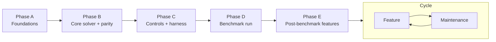

# Roadmap

Planned work, in order. `DECISIONS.md` overrules this file wherever they disagree. Phases are lettered (Phase A, Phase B, and so on) and match decision codes. A phase starts only when its decisions are Decided.

**Scope:** this file covers the implementation. The research project (paper, literature review, benchmark harness, human study) lives in `../PIXSOTA` (`../PIXSOTA/ROADMAP.md`). The benchmark tasks and the blind rating now run there.

**Task format:** `- [ ] <task> (<codes>). Done when: <check>`
- Codes are the decisions the task depends on.
- The check is something the agent can run or observe: a command, a test, a visible behavior.
- A task fits one session and one reviewable diff. If it doesn't, split it.
- Tasks run top to bottom. `[P]` after the checkbox marks a task that can run in parallel with its neighbors because it touches different files.

Phases A to C were built before DLAD was adopted, so their B and C rows are still Questions. Triaging them does not block Phase D, but a change to any of them reopens the matching task.

## Phase A: Foundations

**Goal:** the method, language, colour space and reference are fixed.
**Exit:** A1 to A5 Decided.

- [x] Fix method, language, colour space, reference and compute location (A1–A5). Done when: rows Decided.

## Phase B: Core solver and Pyxeled parity (milestones 1–3)

**Goal:** a working Rust port that matches Pyxeled in compat mode and runs at 512.
**Exit:** parity table in `docs/PORTING.md`; 512 profile in `bench/out/prof/`.

- [x] Crate, CLI and MCDA core (A1, A2, B4). Done when: `cargo test` passes.
- [x] Pyxeled parity with compat mode (A4, B1, B2). Done when: `bench/parity.py` shows compat f64 ΔE vs Pyxeled < 1.
- [x] 512 output profile (B2, B3). Done when: `bench/out/prof/hunter_512.json` exists with timings.

## Phase C: Importance map, edge weight, benchmark harness (milestones 4–5)

**Goal:** artist controls exist, and a harness can judge them.
**Exit:** smoke benchmark runs end to end.

- [x] Importance map (C1). Done when: `--importance` changes p(s) and the run completes.
- [x] Experimental edge weight, off by default (C2). Done when: no edge map means no change in output.
- [x] Benchmark harness, blind sheet and scoring (C3, C4). Done when: the 2-image smoke run at 128 is in `bench/out/smoke/`. The harness has since moved to `../PIXSOTA/bench/`; the smoke output stays here as generated data.

## Phase D: Benchmark run and report

**Goal:** objective numbers for all four columns, reported before any feature work (D1).
**Exit:** objective table in `../PIXSOTA/docs/BENCHMARK.md`. The blind rating and its verdict (F27, formerly C4) are research work and belong to `../PIXSOTA/ROADMAP.md`, not to this repo.
**Out of scope:** solver changes, tuning, new features.
**Status:** done.

- [x] Prepare the remote run (`../PIXSOTA/bench/remote_wsl.sh`): script or notebook that builds the release binary and venv and runs `run_bench.py` (D2, A5). Done when: it runs the 2-image smoke config remotely and returns `results.csv`.
- [x] Full run (C3, D2). Done when: the results table has 96 rows (8 images × 3 sizes × 4 methods), copied back locally. Archived in `../PIXSOTA/data/phase-d/results.csv`.
- [x] Objective table (C3). Done when: `summarize.py` output is in `../PIXSOTA/docs/BENCHMARK.md`.

## Phase E: Post-benchmark features

**Goal:** three methods (E8): base PIA, PIA + importance map, and PixelOE (Phase G). Edge weight cut (E1).
**Not now:** GUI (E2), palette per material (E3).

- [x] Format once (E4): `cargo fmt` in a formatting-only commit, and add `cargo fmt --check` to the verification commands in `AGENTS.md`. Done when: `cargo fmt --check` is clean and `cargo test` passes. (2026-11-17: outputs byte-identical after formatting.) Each feature that is kept may get its own letter.

- [x] Cut the edge weight (E1, C2): remove `--edge-weight`, its cost term, tests and docs. Done when: `cargo test` and `cargo clippy` pass, `--edge-weight` is rejected, and `bench/parity.py` compat output is unchanged (A4, B1). (2026-11-17: 3 tests pass, 0 clippy warnings, flag rejected; compat, default, smoke and importance outputs byte-identical to before; parity f32 ΔE 1.60.)
- [x] [P] Automatic importance map (E7, C1): `--importance auto` computes spectral-residual saliency in Rust. Done when: a test shows the map matches the harness's `spectral_residual` on a fixed image within 1/255 mean, and `cargo test` and `cargo clippy` pass. (2026-11-17: exact match, 0 differing pixels on 2 fixtures; on the 6 showcase images at 128 the output equals the harness's `pia_imp` byte for byte.)

## Phase G: PixelOE in Rust

**Goal:** a Rust port of PixelOE that matches the Python original and is much cheaper to run (G1).
**Out of scope:** PIA solver changes (E5).
**Exit:** `piaru --method pixeloe` covers every PixelOE stage, and its parity check passes the G5 bound.

- [x] Building blocks (G1, G2): kornia CIELAB conversions, the soft circle kernels, erode/dilate and the local median/min/max stat from `pixeloe/torch/{lab,minmax,outline}.py`. Done when: unit tests compare against values dumped from the Python functions. (2026-11-17: references from `bench/pixeloe_ref.py` on the ASUS, torch 2.15.0, kornia 0.9.2, pixeloe 1.0.0. Kernels, erode and dilate bit-exact; Lab within 6.1e-5 (L 0..100); Lab→RGB within 2.3e-6; local stats within 1.2e-7.)
- [x] Outline expansion and edge-weight map (G2): `torch/outline.py`. Done when: the expanded image and weight map match Python on a test image for every weight mapping and thickness 1–3. (2026-11-17: weights within 1.9e-6, expanded image within 2.4e-7. The padded image `b` is covered by the full-pipeline task.)
- [x] Measure and propose the parity bound (G3, G5). Done when: a G5 proposal with measured numbers is in `DECISIONS.md` for the user. (2026-11-17: stages so far within 2.4e-6; G5 Decided.)
- [x] Downscale modes (G2): contrast-based, k-centroid, Lanczos and the conventional modes. Done when: each matches Python within the G5 bound. (2026-11-17: Lanczos, nearest, nearest-exact, area bit-exact; contrast 6.3e-7, bilinear 6e-8, bicubic 1.2e-7; k-centroid exact on 104/120 patches, the 16 ties follow G6.)
- [x] Sharpen (G2): Laplacian and unsharp. Done when: matches Python within the G5 bound. (2026-11-17: unsharp 1.8e-7, Laplacian 4.2e-7.)
- [x] Colour step (G2): k-means palette, colour transfer, dithering (`torch/color.py`). Done when: matches Python within the G5 bound. (2026-11-17: Gaussian kernels bit-exact via f16 rounding; wavelet blur 1.8e-7, match_color 1.8e-6; k-means palette, quantise, ordered and error-diffusion dither 1.2e-7. Weighted/repeat k-means are checked end to end in the pipeline task.)
- [x] Pipeline and CLI (G4): `piaru --method pixeloe` with PixelOE's options and the existing `--stats` shape. Done when: `cargo test`, `cargo clippy` pass and the smoke run works with `--method pixeloe`. (2026-11-18: 17 upstream configs within 2.4e-6; flags per G7–G9; smoke 128×80 in 1.2 s, 56 MiB; PIA output byte-identical.)
- [x] Parity check (G3, G5): a `bench/` script runs both on the test images. Done when: mean ΔE is under the G5 bound on every image, results in `docs/PORTING.md`, and the 512 peak memory and time are recorded next to the torch numbers. (2026-11-18: 12/12 within G5, worst mean ΔE 0.001; 512: torch 6.0 s / 1.6 GB, PIARU 15 s / 350 MiB.)

## Cycle: feature and maintenance

No end state. Once the planned phases are done, work repeats this loop. Each turn is a small phase of its own: new decisions first, then tasks.

**Feature turn**
1. Add the idea as a Question row in `DECISIONS.md`. Triage it to TBD, Inspect or Decided.
2. When its rows are Decided, add tasks here under a new lettered phase, in the usual task format.
3. Build, verify, and tick each task only when its check passes.

**Maintenance turn** (per release)
- [x] Dependencies reviewed and upgraded where needed. Done when: `Cargo.lock` updated, `cargo test` and `cargo clippy` clean. (2026-11-15: crc32fast, itoa, syn patch bumps; 3 tests pass, 0 clippy warnings.)
- [x] Parity still holds (A4, B1). Done when: `bench/parity.py` compat f64 ΔE vs Pyxeled < 1. (2026-11-15: f64 0.46, f32 1.60, 97 % / 94 % within ΔE 5; f32 output byte-identical to the pre-maintenance build.)
- [x] Docs match reality. Done when: no Decided row contradicts the code, `ARCHITECTURE.md` or `docs/PORTING.md`. (2026-11-15: f64 parity row corrected from 0.49 to 0.46 in `PORTING.md`, `DECISIONS.md` B2 and `ARCHITECTURE.md` H.)
- [ ] Stale rows closed or reopened. Done when: no TBD, Inspect or Question row older than one cycle. (2026-11-17: E1–E4 Decided; only G5 is open, and it is Inspect by design.)
