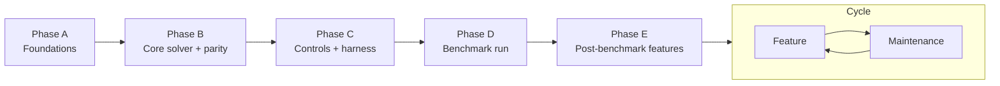

# Roadmap

Planned work, in order. `DECISIONS.md` overrules this file wherever they disagree. Phases are lettered (Phase A, Phase B, and so on) and match decision codes. A phase starts only when its decisions are Decided.

**Scope:** this file covers the implementation. The research project (paper, literature review, benchmark harness, human study) lives in `../PIXSOTA` (`../PIXSOTA/ROADMAP.md`). The benchmark tasks and the blind rating now run there.

**Task format:** `- [ ] <task> (<codes>). Done when: <check>`
- Codes are the decisions the task depends on.
- The check is something the agent can run or observe: a command, a test, a visible behavior.
- A task fits one session and one reviewable diff. If it doesn't, split it.
- Tasks run top to bottom. `[P]` after the checkbox marks a task that can run in parallel with its neighbors because it touches different files.

Phases A to C were built before DLAD was adopted, so their B and C rows are still Questions. Triaging them does not block Phase D, but a change to any of them reopens the matching task.

## Phase A: Foundations

**Goal:** the method, language, colour space and reference are fixed.
**Exit:** A1 to A5 Decided.

- [x] Fix method, language, colour space, reference and compute location (A1–A5). Done when: rows Decided.

## Phase B: Core solver and Pyxeled parity (milestones 1–3)

**Goal:** a working Rust port that matches Pyxeled in compat mode and runs at 512.
**Exit:** parity table in `docs/PORTING.md`; 512 profile in `bench/out/prof/`.

- [x] Crate, CLI and MCDA core (A1, A2, B4). Done when: `cargo test` passes.
- [x] Pyxeled parity with compat mode (A4, B1, B2). Done when: `bench/parity.py` shows compat f64 ΔE vs Pyxeled < 1.
- [x] 512 output profile (B2, B3). Done when: `bench/out/prof/hunter_512.json` exists with timings.

## Phase C: Importance map, edge weight, benchmark harness (milestones 4–5)

**Goal:** artist controls exist, and a harness can judge them.
**Exit:** smoke benchmark runs end to end.

- [x] Importance map (C1). Done when: `--importance` changes p(s) and the run completes.
- [x] Experimental edge weight, off by default (C2). Done when: no edge map means no change in output.
- [x] Benchmark harness, blind sheet and scoring (C3, C4). Done when: the 2-image smoke run at 128 is in `bench/out/smoke/`. The harness has since moved to `../PIXSOTA/bench/`; the smoke output stays here as generated data.

## Phase D: Benchmark run and report

**Goal:** objective and blind-rated numbers for all four columns, reported before any feature work (D1).
**Exit:** report in `../PIXSOTA/docs/BENCHMARK.md` with the C4 verdict.
**Out of scope:** solver changes, tuning, new features.
**Blocked on:** nothing. D2, C3 and D4 are Decided. The report and its remaining task are tracked in `../PIXSOTA/ROADMAP.md`.

- [x] Prepare the remote run (`../PIXSOTA/bench/remote_wsl.sh`): script or notebook that builds the release binary and venv and runs `run_bench.py` (D2, A5). Done when: it runs the 2-image smoke config remotely and returns `results.csv`.
- [x] Full run (C3, D2). Done when: the results table has 96 rows (8 images × 3 sizes × 4 methods), copied back locally. Archived in `../PIXSOTA/data/phase-d/results.csv`.
- [x] Objective table (C3). Done when: `summarize.py` output is in `../PIXSOTA/docs/BENCHMARK.md`.
- [ ] Blind rating (C4, D4). Moved to `../PIXSOTA/ROADMAP.md`. Phase D closes when that verdict reaches `../PIXSOTA/docs/BENCHMARK.md`.

## Phase E: Post-benchmark features

**Goal:** chosen after Phase D.
**Blocked on:** E1–E4 (TBD). Each feature that is kept may get its own letter.

- [ ] Act on the weight-in-cost verdict (C4, E1). Done when: code cut, or kept opt-in with the verdict cited in `../PIXSOTA/docs/BENCHMARK.md`.

## Cycle: feature and maintenance

No end state. Once the planned phases are done, work repeats this loop. Each turn is a small phase of its own: new decisions first, then tasks.

**Feature turn**
1. Add the idea as a Question row in `DECISIONS.md`. Triage it to TBD, Inspect or Decided.
2. When its rows are Decided, add tasks here under a new lettered phase, in the usual task format.
3. Build, verify, and tick each task only when its check passes.

**Maintenance turn** (per release)
- [ ] Dependencies reviewed and upgraded where needed. Done when: `Cargo.lock` updated, `cargo test` and `cargo clippy` clean.
- [ ] Parity still holds (A4, B1). Done when: `bench/parity.py` compat f64 ΔE vs Pyxeled < 1.
- [ ] Docs match reality. Done when: no Decided row contradicts the code, `ARCHITECTURE.md` or `docs/PORTING.md`.
- [ ] Stale rows closed or reopened. Done when: no TBD, Inspect or Question row older than one cycle.
